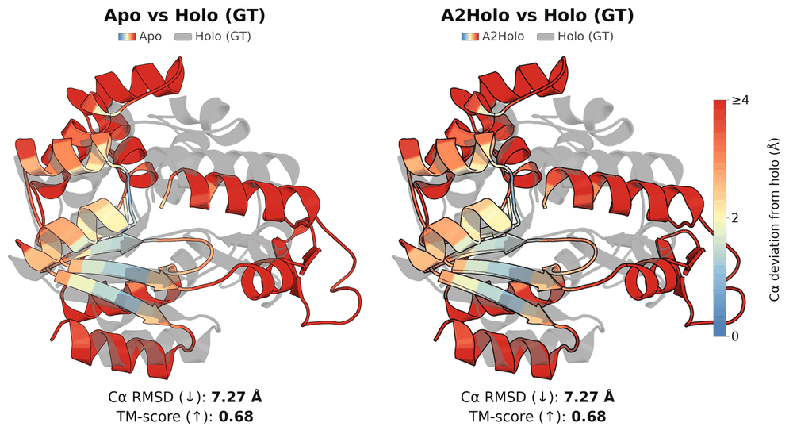
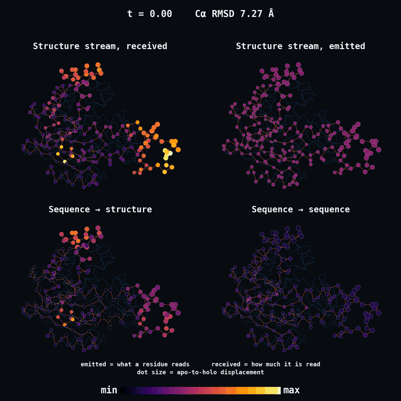
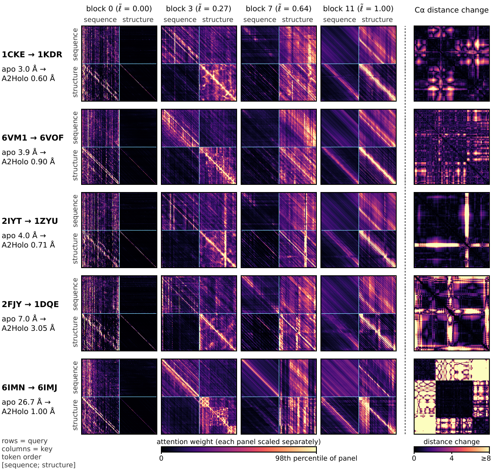

# A2Holo

<p align="center">
  
  
  
  
  
  
</p>

**Dual-Stream Flow Matching of 3D Structure and a Protein Language Model for
Conformational Transition Prediction**

<p align="center">
  
</p>

<p align="center">
  <i>Test pair 4AKE_A → 4X8L_A, an illustrative pair: its error of 0.48 Å is below the test median. Left,
  the apo input; right, A2Holo integrating from apo (t = 0) to its prediction (t = 1), both over the
  holo target in grey. Colour is per-residue Cα deviation from holo, capped at 4 Å.</i>
</p>

## Overview

A2Holo predicts the conformational transition a protein backbone undergoes on ligand binding:
give it the apo (unbound) structure, it returns the holo (bound) one. It casts apo-to-holo
prediction as flow matching between two *experimental* structures rather than generation from
noise, and transplants the dual-stream joint attention of in-context image generation to
residue-aligned protein language model embeddings and structure.

Without ligand conditioning or stochastic sampling, one deterministic trajectory of 10 Euler steps
reaches a median Cα RMSD of **0.809 Å**, the lowest on the D3PM benchmark — one pose, no
ensembling. Its TM-score exceeds even the target-selected best of 10 samples from every stochastic
baseline, including the previous state of the art, on at least 144 of the 150 test pairs. Cα and
Cβ are predicted jointly.

Beyond performance, the paper measures the transplanted multimodal mechanism itself: because
sequence and structure are residue-aligned, its joint attention can be measured at residue
resolution and tested for reproducibility across independently trained model variants. The code
for those measurements is in `analysis/` (see [Mechanism analyses](#mechanism-analyses)).

This is the anonymous code release accompanying our submission. It holds the code to train the
model with the reported recipe and to evaluate a checkpoint exactly as its Table 1 row, the step
comparison and the TM-scores were measured. A new training is a new draw of that recipe: five trainings of it (seeds 1 to 5) span
medians of 0.761 to 0.836 Å. Preprocessed tensors are not included; the trained checkpoints are
listed in [CHECKPOINTS.md](CHECKPOINTS.md).

## Quick start

```bash
conda create -n a2holo python=3.12 && conda activate a2holo
pip install -r requirements.txt
```

```bash
python scripts/train.py --seed 1                                                 # the reported recipe
python scripts/evaluate.py --checkpoint checkpoints/a2holo_seed1/best_model.pt  # D3PM test set
examples/allatom_and_tm.sh checkpoints/a2holo_seed1/best_model.pt               # TM-score + all-atom
```

Every default is the reported setting, so these commands need no other flags. `evaluate.py` writes
`best_model_test_results.json` next to the checkpoint; for the released checkpoint its Cα median is
0.809 Å. `requirements.txt` adds the PyTorch CUDA 13.0 wheels as an extra index; drop that line for
another CUDA version or for CPU.

Two tools are installed separately:

| Tool | Used for | Located via |
|---|---|---|
| USalign | TM-score | `$USALIGN`, or `USalign` on `PATH` |
| cg2all | all-atom reconstruction from the predicted Cα trace | `$CONVERT_CG2ALL`, or `convert_cg2all` on `PATH` |

## Data

The D3PM apo–holo pairs (Peng et al., 2022) as curated by SBAlign (Somnath et al., UAI 2023):
1,591 pairs, split 1,291 train / 150 validation / 150 test and used unchanged. The split is shipped as
`data/d3pm_splits.json`, so the test set is exactly reproducible; the structures are not.

1. Clone SBAlign into `data/sbalign/` (or set `SBALIGN`) and put its D3PM data (Zenodo record `8066711`) under
   `data/sbalign/data/raw/d3pm/` (`conformations/`, `splits.json`, `conf_pairs.txt`).
2. Build SBAlign's Cα-only tensors, which carry the `x [N, 145]` node features and the common apo/holo
   frame:

   ```bash
   cd data/sbalign && PYTHONPATH=. python scripts/conf/preprocess.py --data_dir data \
       --dataset d3pm --resolution c_alpha --center_conformations
   ```

3. `examples/preprocess.sh` adds Cβ, superposed with the same transform as Cα (glycine gets
   AlphaFold2's virtual Cβ and `cb_mask = 0`), and computes Ankh3-large embeddings from the sequence
   stored in the tensors, so their lengths always match the structure. `ESM=1` adds ESM-2 and ESM-C
   embeddings.

```
data/d3pm/pairs/<pair>.pt    Cα + Cβ tensors and node features
data/d3pm/ankh3/<pair>.pt    per-residue embeddings [N, 1536] and the global token
data/d3pm_splits.json        shipped
```

`DATA_DIR`, `EMB_DIR` and `SPLITS` override these locations.

`data/apollodiff_splitA.json` is the protein-disjoint split of the appendix (1,425 / 45 / 58 pairs),
built with the procedure of Zhang et al. (2023, Appendix C). Score a checkpoint only on the split it
was trained on.

## Usage

### Training

`scripts/train.py` trains the reported recipe from scratch; `--help` lists it. Seed 1 is the released
checkpoint's; seeds 2 to 5 are the other four trainings of the recipe. A run writes
`checkpoints/a2holo_seed<seed>/best_model.pt` and takes about 20 h on a single 96 GB GPU.

Every 5 epochs the EMA weights are validated with one Euler step, and the checkpoint kept is the one
with the lowest mean validation Cα RMSD. The learning rate, 1e-4 scaled by batch size / 32, is
multiplied by 0.7 once validation has not improved for more than 3 checks, and training stops after
30 checks without improvement or at epoch 700. For every seed and every ablation arm in the paper,
this rule selects the reported checkpoint.

The seven models on the protein-disjoint split:

```bash
S="--splits data/apollodiff_splitA.json --patience 200"
python scripts/train.py $S --out_dir checkpoints/splitA_recipe
python scripts/train.py $S --depth_double 4 --depth_single 4 --out_dir checkpoints/splitA_depth4
python scripts/train.py $S --no_plm --depth_double 0 --out_dir checkpoints/splitA_no_plm
python scripts/train.py $S --seq_from_structure --no_global_token --out_dir checkpoints/splitA_seq_from_structure
python scripts/train.py $S --attention cross --out_dir checkpoints/splitA_cross_attention
python scripts/train.py $S --plm esm2 --out_dir checkpoints/splitA_esm2
python scripts/train.py $S --plm esmc --out_dir checkpoints/splitA_esmc
```

### Evaluation

`scripts/evaluate.py --checkpoint <best_model.pt>` integrates the flow from each apo structure with 10
Euler steps on `t_k = k/10`, using the EMA weights, and reports Cα RMSD after Kabsch superposition and
Cβ RMSD under the same superposition. One test pair (`7JG9_B_7JGA_A`) has a backbone-only apo model, so
Cβ statistics cover 149 pairs. Ten steps beat a single step on 99 to 116 of the 150 test pairs in
every training, and a hundred differ from ten by a median of 0.0008 Å per pair (`--num_steps`).
It also reports Cα lDDT against holo (inclusion radius 15 Å, thresholds 0.5, 1, 2 and 4 Å) for the
prediction and for the apo input. `--split val` scores the validation split, `--splits` another split
file, and `--pdb_dir` also writes the predicted, holo and apo structures.

### Ablations

```bash
examples/ablations.sh no-plm            # no sequence stream, and so no double-stream blocks
examples/ablations.sh no-node           # node features zeroed, capacity unchanged
examples/ablations.sh no-global-token   # global token zeroed, per-residue embeddings kept
examples/ablations.sh depth 4 8 16      # equal double- and single-stream depth, one run per value
```

Each arm is `train.py` with one component changed, and evaluation reads the architecture from the
checkpoint. The paper's ablation reports one arm, no-plm, trained from scratch under the default
recipe and stopping rule and compared with the released seed-1 checkpoint.

Controls on the protein-disjoint split: `--seq_from_structure --no_global_token` (the sequence stream
takes the structure input), `--attention cross` (cross-attention, same size) and `--plm esm2|esmc`.

### TM-score, all-atom and rotation consistency

`examples/allatom_and_tm.sh <best_model.pt>` writes the predicted, holo and apo structures, scores the
prediction and the unchanged apo input against holo with USalign, and rebuilds all-atom models from the
predicted, apo and holo Cα traces with cg2all. cg2all assigns histidine protonation states at random, so
its all-atom output varies slightly between runs. The baseline TM-scores in the results come from
rerunning each baseline's released code and weights (10 samples per pair); that code is not here.

`analysis/splitA_tables.py` computes the appendix tables and per-pair tests from `evaluate.py --pdb_dir`
output and baseline samples (`sample<k>/<pair>.pdb`); with `--splits data/d3pm_splits.json` it gives the
backbone measures of the D3PM evaluation. `--help` lists the inputs. The baseline code is not here.

`scripts/rotation_consistency.py --checkpoint <best_model.pt>` reruns the evaluation under 100
Haar-uniform rotations of the input. Rotation consistency is trained, not built in, so it is measured
rather than guaranteed, and the score moves far less than the prediction does. For the released
checkpoint the Cα RMSD to holo changes by a median of 0.005 Å (`ca_deviation_abs_median`; the signed
mean is +0.006 Å) and one of the 150 pairs moves by more than 0.5 Å under some rotation. The
prediction itself, turned back into the original frame, sits 0.075 Å from the unrotated one in shape
(`turned_back_shape_median`) and 0.51 Å as it stands; nearly all of that difference is translation,
which neither the loss nor any reported metric sees.

### Mechanism analyses

```bash
examples/analysis.sh <checkpoint_dir> [label]    # needs a GPU; writes outputs/analysis/<label>/
```

These are the measurements behind the paper's account of the joint attention and the
structure-stream states: attention each residue emits and receives within the structure stream,
the sequence stream's attention to structure against its attention to itself, the same overlap
conditioned on an apo-geometric baseline, how decodable the transition is from each block's
states relative to the language-model embedding alone, how each block's update aligns with the
readout, and what damping a block or masking an attention quadrant does to the prediction.

<p align="center">
  
</p>

<p align="center">
  <i>Test pair 4AKE_A → 4X8L_A, adenylate kinase closing its lid, from apo (Cα RMSD 7.27 Å) to the
  prediction (0.48 Å, below the test median). Each point is a residue, sized by its apo-to-holo
  displacement and coloured by head-averaged joint attention, averaged over the twelve double-stream
  blocks at each step: within the structure stream, the attention a residue receives (top left) and
  emits (top right); below, the attention the sequence stream pays to structure and to itself. One
  colour scale serves all four panels, so they compare: received concentrates on the residues that
  move, and emitted does not. Integrated in 60 steps for a smooth animation, where the deployed model
  uses 10; ten steps and a hundred are separated by a median of 0.0008 Å per pair, so the path drawn
  here is the deployed one at finer spacing. The attention here comes from
  the model's own states along the trajectory, not from the interpolated input the analyses use. This
  pair is chosen for legibility and is not typical; one pair from the released checkpoint, for
  illustration.</i>
</p>

The analysed input is `(1 − t)·x_apo + t·x_holo`, and the script runs everything at `t = 0.5` and at
`t = 0` (`TLIST` changes that). At `t = 0` the forward pass is the model's own one-step prediction, and
the run starts with a gate that checks this pair by pair against `evaluate.py --num_steps 1`; if the
gate fails, nothing else runs. Every script also checks that its hooks fired on each forward pass.

`CONTROLS=1` adds the random-weights control at each time. The seed control compares several
trainings of one recipe, so it takes their checkpoint directories:

```bash
python analysis/run.py --script analysis/emit_recv_controls.py --t 0.5 --mode seeds --max_pairs 150 \
    --seed_models seed1=checkpoints/a2holo_seed1 --seed_models seed2=checkpoints/a2holo_seed2 \
    --seed_models seed3=checkpoints/a2holo_seed3 --seed_models seed4=checkpoints/a2holo_seed4 \
    --seed_models seed5=checkpoints/a2holo_seed5
```

`python analysis/summarize.py KIND TSV` reduces an output table to per-model values and the agreement
across models. The scripts run on any joint-attention, Ankh3 checkpoint this code trains; the
architecture variants the paper compares them across were trained with an earlier version of the code.

## How it works

**The flow.** Linear interpolation, `x_t = (1 − t)·x_apo + t·x_holo`, with `t = 0` at apo and
`t = 1` at holo and no noise anywhere. Cα and Cβ each get their own 3D flow, solved jointly by one
model — two 3D problems, not one 6D one. Supervision is in position space: the model predicts a
velocity and `x_apo + v` is scored.

**The architecture.** The structure stream carries the interpolated Cα+Cβ coordinates with node
features; the sequence stream carries frozen per-residue Ankh3-large embeddings. They pass through
*double-stream* blocks, which keep separate weights per stream and meet only in joint attention,
and then *single-stream* blocks over the merged tokens, the layout of the FLUX.1 and SD3 image
backbones.

Joint attention attends over the `2N` tokens of both streams at once. Both streams are indexed by
residue and share their position ids, so residue `i`'s structure and sequence tokens sit at the same
position. That is what makes the joint map readable residue by residue.

<p align="center">
  
</p>

<p align="center">
  <i>Head-averaged joint attention of double-stream blocks 0, 3, 7 and 11 (counted from 0) in the
  released checkpoint, at the interpolated input with t = 0.5, for the five test pairs of the paper's
  structure gallery: the median-error pair of each of five difficulty levels. Rows are queries and
  columns are keys, in the model's token order, sequence first, and each map is scaled to its own 98th
  percentile. Right, the Cα distance change |d<sub>holo</sub> − d<sub>apo</sub>|, capped at 8 Å. Labels
  give each pair's apo and predicted Cα RMSD to holo. Shown for illustration; the paper's measurements
  are made over the test set and across trainings, not read off single blocks.</i>
</p>

Nothing supervises the attention; the only training signal is the coordinate objective.

**The objective.**

```
L = 0.5·D_Cα + 0.5·D_Cβ + 0.5·(1 − sLDDT_Cα) + 2.0·L_rel
```

`D` is one global Kabsch superposition followed by the mean per-atom distance, with no clamp. Cβ
reuses Cα's transform instead of being aligned on its own, and is masked at glycine. sLDDT is
alignment-free and on Cα only. `L_rel` compares the predicted and true Cα displacements of
neighbouring residues — the 16 nearest in the apo structure plus two sequence neighbours on each
side — as `‖(v_i − v_j) − (v*_i − v*_j)‖`, so a field that is right on average but locally
incoherent is penalised.

## Results

D3PM 150-pair test set, Cα RMSD after Kabsch superposition:

| Method | Sampling | Median | Mean | < 2 Å | < 5 Å |
|---|---|---|---|---|---|
| Apo input (no prediction) | — | 4.46 Å | 6.74 Å | 0 % | 59 % |
| EGNN | single | 19.99 Å | 21.37 Å | 1 % | 1 % |
| SBAlign | 10 samples, pooled | 3.80 Å | 4.98 Å | 0 % | 69 % |
| Sesame | not reported | 2.87 Å | 3.65 Å | 38 % | 82 % |
| ABM | single, 5 trainings | 2.40 Å | 3.49 Å | 43 % | 84 % |
| FDBM | single, 5 trainings | 2.12 Å | 3.34 Å | 48 % | 86 % |
| **A2Holo**, released checkpoint | **deterministic** | **0.809 Å** | **2.357 Å** | **66.7 %** | **88.0 %** |

Cα RMSD of the baselines is quoted as reported by FDBM (Nobis et al., 2025, Table 1); the apo row is
computed here the same way as A2Holo's. The quoted SBAlign row scores every one of its 10 samples per
pair, with no selection among them, as SBAlign's released evaluation code does. Our own single-sample
re-runs of FDBM and ABM score better than the quoted values (Cα median 1.91 and 1.95 Å), so
quoting them enlarges A2Holo's margin. A2Holo integrates 10 Euler steps; its row is the released
checkpoint, seed 1, and the five trainings of its recipe span medians of 0.761 to 0.836 Å.

On TM-score (USalign), the released checkpoint reaches a median of 0.982 and scores higher than the
target-selected best of 10 samples on 144 of 150 pairs against FDBM, 145 against ABM and 150 against
SBAlign, and on 120 against the untouched apo input.

## Project structure

```
a2holo/                         model, data, geometry, checkpoints, PDB output
scripts/
  train.py                      training, and every ablation by flag
  evaluate.py                   D3PM evaluation; --pdb_dir for the structures
  tm_score.py                   TM-score with USalign
  allatom_cg2all.py             all-atom reconstruction with cg2all
  rotation_consistency.py       evaluation under random rotations of the input
  add_cb.py                     SBAlign's Cα tensors + CIFs -> Cα+Cβ tensors
  embed_ankh3.py                Ankh3-large embeddings
  embed_esm.py                  ESM-2 650M and ESM-C 300M embeddings
analysis/
  common.py, run.py                       shared loaders and attention capture; runner
  validate_oneshot_readout.py             gate: analysis forward = one-step prediction
  emit_recv_reference_set.py              emitted vs received attention per quadrant
  emit_recv_controls.py                   random-weights and seed controls
  attention_conditional.py                overlap conditioned on apo geometry
  geometric_baselines.py                  apo-geometry baselines, no model
  decodability_relative_reference_set.py  transition decodability per block
  update_alignment.py                     block update size and readout alignment
  quadrant_intervention.py                masking attention quadrants
  alpha_scaling_reference_set.py          damping each block's update
  attention_gif.py                        the animated attention figure above
  splitA_tables.py                        model, baseline and backbone tables (protein-disjoint, D3PM)
  summarize.py                            per-model values and agreement
examples/                       preprocessing, ablations, TM + all-atom, analyses
data/d3pm_splits.json           the D3PM split
data/apollodiff_splitA.json     the protein-disjoint split (procedure of Zhang et al. 2023, Appendix C)
CHECKPOINTS.md                  the trained checkpoints and how each one is evaluated
```

## Weights

The trained checkpoints are not part of this snapshot: [download them](https://drive.google.com/drive/folders/1YFTKxH1YVJHKMlWIu16oKxbJewJGXuvi?usp=sharing);
[CHECKPOINTS.md](CHECKPOINTS.md) lists them. Everything here also trains from scratch.

Also not here: the rendering scripts of the other two figures; baseline implementations, better
taken from their own repositories (SBAlign, FDBM, EGNN); preprocessed tensors; embeddings.

## License

Apache License 2.0 — see [LICENSE](LICENSE). The copyright line reads
"Anonymous Authors" for the duration of review.

## Anonymity

This snapshot carries no author, institution or infrastructure information.
